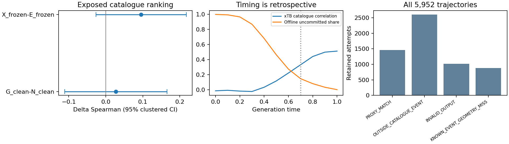

# S4: information evidence and promotion gate

**Decision: inconclusive for the declared strict connected-channel endpoint;
do not launch S5/#188.** This is the #187 audit, not a new fitted probe or a
renamed trajectory sweep. The new question is whether corrected implementation
identity/accounting and measured local trained response resolve the endpoint
and conditioning gap left by the old catalogue studies. They do not yet do so.

Clean source `d18de80` (full SHA in the [receipt](incremental_signal.json)) read
the exact retained check-A rows and 5,952 check-B trajectories on node2. Input
hashes match the original e5ceb870 evidence/SHA256SUMS. No head was refitted,
trajectory regenerated or physical observation recomputed. The run took
0.855315 s wall / 0.796641 s CPU, zero model/training/GPU/QC work, under the
[frozen audit limits](../../../configs/research/incremental_signal_audit_20261111.json).

The paired G_clean−N_clean ranking difference reproduces **+0.02714296**,
formula-clustered 95% interval **[-0.11096317,+0.16524908]**, 62 parents/21 formula
groups/558 known channels. The different-architecture X_frozen−E_frozen contrast
is +0.09544559 [-0.02655839,+0.21744957]; it cannot isolate geometry. These ranges
include harm and potentially useful gains. No practical effect is excluded.

The median offline commitment time is .50, and retained xTB correlations reach
the old informative-time rule at .70. Only **14.546% of valid-final trajectories**
remain uncommitted then. That denominator is 4,936, not all 5,952; commitment
uses the future trajectory and cannot be a live trigger.



The figure is regenerated by `scripts/audit_narrowed_signal.py`. The left panel
uses parent/family uncertainty, the middle panel uses the original retrospective
definition, and the right panel retains all attempted trajectories. It does not
plot causal strict-channel effects, which have not been estimated.

| Retained population | Count | Use and limitation |
| --- | ---: | --- |
| All trajectories | 5,952 | Full denominator, including failures/outside catalogue |
| Valid final event | 4,936 | Offline commitment denominator |
| Invalid output | 1,016 | Retained, not replaced |
| Outside-catalogue event | 2,600 | No catalogue barrier target; not necessarily failed chemistry |
| Known event, geometry miss | 876 | Catalogue label exists; proxy miss |
| Proxy match | 1,460 | Proxy geometry match, not frequency/IRC certification |
| Catalogue-labelled trajectories | 2,336 | Only these may enter catalogue correlations; per-time physical missingness further reduces support |

Per-time `eligible_rows`, physical failure/collision statuses and parent counts
remain in the JSON. Unknown catalogue labels are not converted to zero barriers.

## Old result → remaining question → current audit

| Old result | Unresolved question | Action here |
| --- | --- | --- |
| Geoinfo: matched increment inconclusive | Geometry increment for strict discovery? | Reaggregate existing frozen predictions; no strict-label equivalence |
| Geometry-lead: window .145 → .279/.346 | Does delayed commitment improve decisions? | Retain result; no new clock selection or trajectory |
| pg-1: event changes, weak/non-specific utility gain | Direction transport, amplitude and channel quality? | S1 adds numerical transport/response; does not infer physical benefit |
| Equal NFE: -0.0160 AUC [-.0451,+.0131] | Can coupling beat an optimized serial cost allocation? | Require a strong adaptive serial before any advantage claim |
| Strict SMC: NO_GAIN_OVER_POSTHOC | Is an intervention better than terminal selection? | Retain negative/inconclusive controls and original failed smoke |
| Rule same_endpoint / trained mixed outcomes | Which implementation and stage actually ran? | S2/S3 restore exact identity, cached decoded handoff and reasons; no retrospective causality claim |

## Feature, label and information boundary

| Quantity | Availability | Permitted interpretation |
| --- | --- | --- |
| Reactant geometry/BE and current event/geometry/clocks | Inference, if mapped and provenance-qualified | Legal present-state covariates |
| E_frozen/N_clean predictions | Existing fitted models, retrospective cache | Event/reactant comparator; no new tuning |
| G_clean true-TS geometry | Reference-only privileged feature | Information upper-bound study, never live input |
| h_X | Reads geometry **and event state** | Not pure geometry information |
| xTB at predicted endpoint | Could be an online observation under a qualified protocol | Retained observations only in this audit |
| Eventual event, catalogue barrier, commitment time | Retrospective labels | Analysis only; never trigger feedback |
| S1 fixed centered perturbation | Numerical diagnostic | Measures response, not a physical signal |
| Strict TS/mode/IRC/endpoint labels | Independent certification output | No broad matched dataset/probe exists for the selected DA task |

The existing T1x predictors are not a matched frozen predictor pair for the
chosen Diels–Alder strict-channel task. This is an evidence/support gap, not
evidence that geometry contains no information. Conditionally shuffled guidance
is **not executed**: compatible parent/event/time support, geometry validity and
exchangeability are not qualified for the selected task. Arbitrary shuffling
would not identify a geometry contribution. Online feedback is disabled; any
future eligibility protocol may use only current legal geometry/event margin,
clocks and observation reliability, never future commitment or reference TS.

S1 finds nonzero local BE response and nonidentity transport. S2's chemical
bridge is cached calibration; a newly intervened trained state has not been
traced to a decoded final event and independent endpoints. S3's software fixes
and old-artifact audit improve traceability, not treatment outcomes. There is
no new exact-endpoint signal or registered discriminating causal pilot here.
S5 lacks an exact-endpoint usable signal or a registered discriminating plan,
and the complete newly intervened trained chemical chain remains unqualified.
Strong adaptive serial and genuinely unexposed confirmation data are separate
later S6 efficacy requirements, not additional prerequisites invented for a
one-parent S5 calibration pilot. Information alone would not establish efficacy.

No strict-channel effect interval is estimable from this audit. The logical
probability-difference bounds [-1,+1] are **not a confidence interval**. S0's
planning threshold of +0.10 cannot be excluded or established. No independent
confirmation pool has been verified. S6 therefore follows its bounded
inconclusive path, with no sample replacement, threshold relaxation or QC launch.

## Replay

```bash
ssh n2 '
  cd "$XTB_SIGNAL_CODE"
  test "$(git rev-parse HEAD)" = "$XTB_SIGNAL_SOURCE_SHA"
  test -z "$(git status --porcelain)"
  source ~/miniconda3/etc/profile.d/conda.sh
  conda activate xtbflow
  export CUDA_VISIBLE_DEVICES= OMP_NUM_THREADS=1 OPENBLAS_NUM_THREADS=1 MKL_NUM_THREADS=1
  timeout 600 python scripts/audit_narrowed_signal.py \
    --heads "$XTB_CACHED_HEAD_ROWS" --trajectories "$XTB_CACHED_TRAJECTORIES" \
    --out "$XTB_NEW_SIGNAL_AUDIT"
'
```

`XTB_SIGNAL_SOURCE_SHA` is the full executed SHA in the receipt. The script
checks frozen input hashes, 256 MiB input/16 MiB output, and 600 CPU seconds;
the command adds the wall limit. It refuses output overwrite. n2 validation:
274 pytest tests/68 subtests, 56 reusable tests, bootstrap 344 files; see
[software receipt](s4_software.json). These are software checks, not additional
independent scientific samples.
