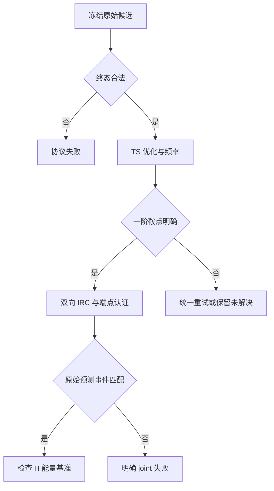

# xtbflow V1b 第一轮验证推进指导：概率抽样与 DFT 通道认证

2026-10-07 · v2.1 · 配套《xtbflow V1a 第一轮验证推进指导》v2.1

> **v2.1 修订要点（相对 v2.0）**
>
> 1. **阶段 B 改为认证 V1a 自己的主终点。** v2.0 的阶段 B 估计“预算 16 下任何严格认证、能量在 H 基准 +2 kcal/mol 内的通道”，含目录外新事件，与 V1a 主终点在能量窗口、事件范围和预算点上都不同；结论不一致时无法区分代理失效与估计对象差异。v2.1 只认证预测事件属于最佳已知事件的候选，估计 Δ^cert = Δ^proxy + D：Δ^proxy 由 V1a 普查已知，抽样误差只来自认证修正量 D。判定一个母体“未命中”不再需要解决整个 bundle。
> 2. **新增唯一预注册决策。** Δ^cert 单侧 95% 下界 > 0 为 `V1A_CONFIRMED`，上界 ≤ 0 为 `V1A_OVERTURNED`，其余为 `V1B_INCONCLUSIVE`（第 10.5 节）。
> 3. **第一轮固定直接 IRC，删除 QRC 两相抽样。** 阶段 A 改为单相分层抽样；QRC 留待下一轮按 D1 实测成本另行评估（第 7 节）。
> 4. **源总体改为训练 seed 0、采样 seed 0；预算单位改为 B0 等效候选（网络调用计数）**，与 V1a v2.1 一致。
> 5. 目录外真实通道的产率仍由阶段 A 的 `OUTSIDE_CATALOGUE_EVENT` 层估计；“任何通道的真实发现优势”留到下一轮作为独立终点。

## 0. 执行代理须知

V1b 回答两个问题：V1a 的目录代理命中有多少能经规定的 DFT 协议成为真实通道；V1a 主终点（命中最低势垒已知通道）经认证后，B1 相对 A2 的优势是否仍然存在。前者用候选级分层抽样审计；后者用独立母体抽样，只认证预测为最佳已知事件的候选，并给出 V1b 唯一的预注册决策（第 10.5 节）。

**启动条件只有一个：V1a 已生成并冻结 `GO_V1b`。** V1a 的 B0 校准、模型训练、主比较和机制检验属于 V1a。不得为提前获得有利物理案例而绕过该条件。V1b 不重训模型，不改变已冻结的事件、RMSD 代理标签、原始目录能量或生成序列。

**读法。** 按任务 D0 到 D5 顺序实施。每项任务包括输入、执行规格、验收和停止条件。本文代码是拟新增接口及可复制的纯函数规格，不表示仓库已有这些文件，也不表示已安装 ORCA 或已运行量化。实际接入时先核对仓库，再以最少修改实现。

### 0.1 硬性规则

1. 候选源固定为 V1a 五个效率臂 A0、A1、A2、B0、B1 在预算 **16 个 B0 等效候选、训练 seed 0、采样 seed 0** 下的完整前缀；B2 不进入本轮 H 审计。
2. 阶段 A 的候选名单与阶段 B 的母体名单分别随机抽取，均在目标总体的 H 结果出现前冻结。抽样概率必须为正并可追溯。
3. 阶段 A 同时覆盖代理命中与未匹配，包括已知非最优参考匹配、目录外事件、已知事件几何未匹配；不得只挑图片好看的候选。
4. 阶段 B 对抽中母体，判定 A2、B1 bundle 中预测事件属于最佳已知事件集合的全部候选。不同 TS 构象、不同尝试均保留；同一个事件只取一个代表不合格。
5. 第一轮不运行 QRC，严格连通一律用同层级双向 IRC 加两端最低点认证。`OptTS+Freq` 与严格 IRC 是不同证据；只有前者时不能写成严格认证。
6. 候选原始预测事件与精修后实际事件分别保存。DFT 优化改变事件后，不得把实际事件回填成模型原来就预测正确。
7. 原生 T1x 目录能量与 V1b 新算的 H 能量分别保存。代理关联参考势垒不是生成 TS 的势垒，不能作为 H 单点结果使用。
8. 失败、重试、数值 Hessian、双向 IRC、两侧端点优化与频率、参考计算全部计费。全局中断与尚未计算的状态不能当化学阴性。
9. 同图不同反应物构象可计入主图级通道成功，必须另报严格同盆地结果；统一锚点相对能量不得冒称从该锚点出发的完整动力学活化势垒。
10. 不用“候选 PPV × V1a 召回”修正母体 `any()`；母体级修正直接在抽中母体上认证得到。不把本预算点、训练 seed 0 的结果外推成整条 AUC 或相同总量化成本下的效率优越性。
11. V1b 的唯一决策量 Δ^cert、`epsilon_cert` 与决策规则在任何目标 H 计算前冻结；阶段 A 的精度估计、案例面板和补充分析不改变该决策。

### 0.2 为什么不能跳过认证

T1x 使用 ωB97X/6-31G(d)，但其 CINEB 以路径最大垂直力不超过 0.05 eV/Å 为停止标准，随后没有逐条精修 TS。论文明确把目标定位为反应路径附近的构型数据。因此 `transition_state` 字段和参考 R/TS/P 三元组本身，不提供本方案要求的驻点、最终频率和双向 IRC 认证。[1]

ORCA 的 TS 教程要求检查优化收敛、最终结构恰有一个虚频，以及该模式对应所研究的结构变化。频率应与优化使用同一层级。只做 DFT 单点，即使单点能量很低，也不能完成这些检查。[3]

### 0.3 执行顺序与出口

| 任务 | 目的 | 交付物 | 未通过时 |
| --- | --- | --- | --- |
| D0 | 冻结源总体、抽样方案和计算语义 | manifest、候选层与母体层总体表 | 暂不提交目标 H 作业 |
| D1 | 用开发样本实测完整认证链 | 6–10 条链的成本和兼容性报告 | 修复后重新冻结配置 |
| D2 | 参考锚点与指定参考 TS 认证 | 独立 refined reference 表 | 相关低能量终点未知，保留母体 |
| D3 | 阶段 A 候选分层审计 | 加权一阶鞍点率、strict PPV、未匹配层严格产率 | 报边界与不足，不替代阶段 B |
| D4 | 阶段 B：V1a 主终点认证 | Δ^cert、修正量 D、每臂母体级代理精度与漏检率、决策 | 未完成范围明确保留 |
| D5 | 固定口径汇总与验收 | 报告、原始证据、实际成本 | 不凭少数案例升级结论 |

`V1A_CONFIRMED`、`V1A_OVERTURNED`、`V1B_INCONCLUSIVE`、`INCOMPLETE_BOUNDS` 是 V1b 的决策状态，第 10.5 节给出条件与后续动作。它们不反写 V1a 已冻结的 GO，但决定是否进入下一轮独立确认。

## 1. 两个总体、三类标签和能量定义

### 1.1 阶段 A 的候选总体

单位是冻结候选记录 `candidate_id`，包含其所属母体、实验臂和原始终态输出。同样坐标在多次生成中出现，仍是多条抽样单位；可以共用计算，不能因此改变总体权重。

候选总体来自 bundle 的 `candidate_ids`，并与原始终态表核对。存在终态输出的 invalid/fallback 记录保留为已知协议失败。只有生成尝试、没有终态输出的失败记入 `attempt_ids` 和生成失败率，不凭空新增候选，也不能通过丢弃该失败缩减源 GPU 账单。

每个候选保存三个独立标签：

| 字段 | 取 1 的条件 | 不提供的证据 |
| --- | --- | --- |
| `ts_optfreq_success` | 原始候选在冻结预算内精修成满足梯度、Hessian 与模式规则的一阶鞍点 | 尚未证明 R/P 连通与预测事件正确 |
| `strict_joint_graph` | 一阶鞍点通过，严格双向路径及端点证明连接输入 R 图，实际事件匹配原始预测 | 未证明同一个 R 构象盆地，也不等于低能量 |
| `strict_low_graph` | `strict_joint_graph=1` 且 H 相对能量通过第 1.3 节基准 | 不等于实验速率或从单一构象起点的有效活化势垒 |

第一项不因最终发现错误事件而改写为 0。第二项若计算明确落到其他合法事件，记 0，并保存 `actual_event_id`；这条意外发现仅进入补充通道表。各标签均允许未知区间 `[0,1]`，具体原因见第 12 节。

对 V1a `PROXY_MATCH` 的候选，分别报告第一项的一阶鞍点精度、第二项的 **strict PPV**，再报告第三项的低相对能量有效比例。目录外事件和几何未匹配项报告严格有效通道产率；不能把它们统称为代理假阳性。

### 1.2 阶段 B 的母体总体与估计对象

单位是 V1a 已冻结的 `parent_id`，其固定查询为 `query_id`。预算 16 个 B0 等效候选、训练 seed 0、采样 seed 0 固定。

**最佳已知事件集合。** 记 \(E^*_p\) 为原目录最佳参考集合 `Rstar_native[p]`（第 1.3 节）中各记录的事件，按反应物自同构取商。母体 p、实验臂 a 的 bundle 中，预测事件在同一合法原子映射下属于 \(E^*_p\) 的候选组成 \(C^*[p,a]\)，由 V1a 导出的 `best_event_candidate_ids` 给出，无论其参考 RMSD 是否达标。

**代理标签。** \(\widetilde Y_{p,a}\) 为 V1a 在预算 16 处的主命中标签：存在候选与 `Rstar_native[p]` 中某条记录事件一致，且在同一映射下 RMSD≤0.50 Å。它对全部 M 个母体已知，因此

\[
\Delta^{proxy}=\frac1M\sum_{p=1}^{M}\left(\widetilde Y_{p,B1}-\widetilde Y_{p,A2}\right)
\]

是冻结总体上的已知常数，没有抽样误差。

**认证标签。** 候选 c 是认证命中（`best_cert_hit=1`），当且仅当其预测事件属于 \(E^*_p\)、`strict_joint_graph(c)=1`（于是实际事件也属于 \(E^*_p\)），且 \(L^H_{c,p}\le T^H_p+\varepsilon_{cert}\)，默认 \(\varepsilon_{cert}=1.0\) kcal/mol（第 1.3 节）。于是

\[
Y^{cert}_{p,a}=\mathbf 1\{\exists c\in C^*[p,a]:\ \mathrm{best\_cert\_hit}(c)=1\},\qquad
\Delta^{cert}=\frac1M\sum_{p=1}^{M}\left(Y^{cert}_{p,B1}-Y^{cert}_{p,A2}\right).
\]

预测事件不属于 \(E^*_p\) 的候选按定义不可能成为认证命中（严格认证要求实际事件等于原始预测），不需要为阶段 B 计算；\(C^*[p,a]\) 为空时 \(Y^{cert}_{p,a}=0\)，无需任何 QC。

**修正量。** 记 \(\delta_{p,a}=Y^{cert}_{p,a}-\widetilde Y_{p,a}\in\{-1,0,1\}\)：代理命中未被认证为 −1（代理假阳性）；代理未命中却被认证为 +1（代理漏检，例如几何未达 0.50 Å、但精修后落到最佳 TS）。则

\[
\Delta^{cert}=\Delta^{proxy}+D,\qquad
D=\frac1M\sum_p\left(\delta_{p,B1}-\delta_{p,A2}\right).
\]

阶段 B 的抽样只用于估计 D。代理越准，D 的变异越小，所需认证越少。

`M` 包括空 bundle、参考未认证母体和难算母体；缺失导出文件不是空集合。阶段 B 只估计这个冻结有限总体上的配对差，不外推到其他预算点、训练 seed 或新母体。

**为什么不再估计“任何通道”的命中。** v2.0 的阶段 B 估计“任何严格认证、能量在 H 基准 +2 kcal/mol 内的通道”，含目录外新事件。它与 V1a 主终点在能量窗口、事件范围和预算点上都不同；两者结论不一致时，无法区分是代理失效还是估计对象不同，也就起不到认证 V1a 的作用。目录外真实通道的产率仍由阶段 A 的 `OUTSIDE_CATALOGUE_EVENT` 层估计；“真实发现优势”留到下一轮作为独立终点。

V1a 的母体规模在 200–350 内由其功效计划确定。V1b 的抽样母体数另由认证成本和 D 的目标精度确定（第 13.3 节），不自动等于 V1a 总母体数。

### 1.3 统一 H 锚点、阈值和主语义

先将 V1a 固定的原始查询反应物几何同层优化为 `R_anchor_H` 并做最低点频率检查。它必须保留原反应物图、总电荷和多重度。它是冻结起点的优化结果，不宣称是该图的全局最低构象。

V1a 的原目录最佳参考集合记为 `Rstar_native[p]`，由原目录共同锚点电子能量和已冻结并列容差定义。默认只对这个集合中的原始记录做 H 认证。全部目标记录认证通过后，定义：

\[
T_p^H=\min_{r\in Rstar_{native}[p]}(E_{TS,r}^{H}-E_{R,anchor}^{H}),\qquad
L_{c,p}^{H}=E_{TS,c}^{H}-E_{R,anchor}^{H}.
\]

默认低相对能量窗口为 `L_H <= T_H + 2.0 kcal/mol`，用于阶段 A 的 `strict_low_graph`；边界数值容差另固定为 `1e-6 kcal/mol`，不是额外的物理宽容区间。该窗口在目标 H 结果前冻结；V1a 主“原最佳参考联合命中”标签保持原定义。

阶段 B 的认证命中另用 `epsilon_cert=1.0 kcal/mol`，即 `L_H <= T_H + 1.0`，以对齐 V1a 主终点“命中最低参考记录”。它是吸收重新优化、积分网格和软件版本差异的协议容差，不是物理误差估计，在目标 H 结果前冻结。

保存 `threshold_source="refined_original_catalog_best"`。名称使用**原目录最佳参考精修后的 H 基准**，不能称为“所有已知 H 通道的最低势垒”。一个原来非最佳参考可能经 H 精修成为更低参考；默认任务并未穷举它。

若有指定原最佳参考无法认证、连通变成其他事件、锚点改变反应物图，主阈值为未解决。不得只取成功子集的最小值冒充完整基准。可在目标 H 前记录按 native 排名前三的替补列表，但替补阈值只进入注明目标已变的补充分析；主结果保留未知。

### 1.4 同图不同构象怎么记

双向 IRC 的反应物侧最低点记为 `R_endpoint_H`。同原子集合、电荷、多重度和化学图，但构象不同，仍可满足主 `strict_joint_graph`。另存：

\[
L_H=(E_{TS}^H-E_{R,endpoint}^H)+(E_{R,endpoint}^H-E_{R,anchor}^H).
\]

三列分别命名为 `relative_energy_anchor_kcal`、`local_barrier_kcal`、`reactant_conformer_offset_kcal`。这一恒等式不计算锚点到另一构象的互变路径；图级低相对能量结果不能解释为该输入构象的完整反应动力学。

严格同盆地补充标签要求反应物侧端点与锚点优化结果满足预先冻结的构象判定：合法对称原子对应后的 RMSD、关键二面角及稳定最低点一致；不能只靠图相同。建议将 `RMSD<=0.30 Å`、非自由转动关键二面角差 `<=20°` 作为开发校准起点，最终规则在 D1 开发期确认、正式 H 前冻结并全臂共用。这是本协议的操作性盆地相容判定，不是普适化学定理或已计算构象互变路径的证明。

## 2. 文件地图与最少接口

延续 V1a 已核对的仓库路径。下面是拟增文件的职责，不另建训练框架、服务或调度平台。若现有模块已经承担相同职责，直接扩展并在 PR 中说明映射。

| 拟增或扩展位置 | 职责 |
| --- | --- |
| `configs/v1b/audit.yaml` | H 方法、预算、层定义、随机种子、停止规则 |
| `src/xtbflow/v1/qc_protocol.py` | 状态机、输入生成、日志解析、缓存键 |
| `src/xtbflow/v1/audit_sampling.py` | 总体构建、分层 SRSWOR、名单冻结 |
| `src/xtbflow/v1/audit_statistics.py` | 分层 HT、Δ^cert 与修正量、决策函数、未知区间 |
| `scripts/v1b_freeze.py` | 导入 V1a、导出总体和 A/B 名单 |
| `scripts/v1b_run.py` | 按已冻结名单提交或恢复作业 |
| `scripts/v1b_report.py` | 从证据记录生成统计及成本报告 |
| `tests/test_v1b_protocol.py` | 抽样、边界、状态语义与解析 fixture |

每条计算记录必须能沿 `candidate_id -> raw_output_hash -> job_hash -> evidence_hash` 追溯。结果目录至少包含：

```text
artifacts/v1b/<run_id>/manifest.json
artifacts/v1b/<run_id>/source_candidates.jsonl
artifacts/v1b/<run_id>/source_bundles.jsonl
artifacts/v1b/<run_id>/sample_A.jsonl
artifacts/v1b/<run_id>/sample_B_parents.jsonl
artifacts/v1b/<run_id>/native_references.jsonl
artifacts/v1b/<run_id>/refined_references.jsonl
artifacts/v1b/<run_id>/candidate_verdicts.jsonl
artifacts/v1b/<run_id>/parent_verdicts.jsonl
artifacts/v1b/<run_id>/qc_jobs/<job_hash>/
artifacts/v1b/<run_id>/report.json
artifacts/v1b/<run_id>/report.md
```

`native_references.jsonl` 是 V1a 冻结目录的只读副本。H 精修后发现错误时，另写问题记录，不能覆盖 native 字段，也不能改变本轮 V1a 的命中阈值、母体集合或主结果。

## 3. 任务 D0：冻结总体、随机方案和验收条件

**输入：** V1a GO 记录、源码 commit、模型 checkpoint hash、源候选与 bundle、母体—臂代理标签、原始参考目录、计算资源上限。**输出：** 可重建的有限总体、两个独立样本名单和未填 H 结果的 manifest。

### 3.1 源预算的精确定义

只纳入 V1a 训练 seed 0、采样 seed 0 的每条生成流中，累计成本不超过 16 个 B0 等效候选（800 个网络调用单位，按 V1a 冻结成本表）时已完成的候选。完成成本和预算归属沿用 V1a，不因 H 结果变化。所有臂使用同一个预算定义，但候选数可以不同；A2 的事件提议、B1 的引导开销都已计入源预算。

保留每个母体每个臂的 bundle，即使候选为空。核对 `stream_complete=true`、预算、seed、`attempt_ids`、成本累计、`best_event_candidate_ids`、代理标签和 `source_hash`。生产生成器不得看到后续 H、参考 TS 或代理标签；离线分层可以读取已冻结的代理标签。

```json
{
  "fold_id": 0,
  "parent_id": "parent0001",
  "split_group": "formula_key",
  "query_id": "parent0001_anchor0",
  "arm": "B1",
  "training_seed": 0,
  "sampling_seed": 0,
  "source_budget_equiv": 16,
  "source_budget_units": 800,
  "cost_table_hash": "sha256",
  "bundle_id": "parent0001_B1_train0_budget16",
  "candidate_ids": ["candidate0007", "candidate0011"],
  "attempt_ids": ["attempt0007", "attempt0011", "attempt0015"],
  "proxy_best_reference_hit": true,
  "best_event_candidate_ids": ["candidate0007"],
  "stream_complete": true,
  "source_hash": "sha256-of-frozen-source"
}
```

上例数值仅说明字段和单位，不是实测预算。报告中的所有数量必须从实际源文件计算。

### 3.2 阶段 A 的互斥层

先按下表唯一归类，再与 `arm` 交叉形成 `stratum_A`。不得把相同候选同时放进“最低匹配”“近最优匹配”两层。

| 互斥层 | 纳入条件 | 主要问题 |
| --- | --- | --- |
| `MATCH_BEST` | `PROXY_MATCH` 且实际匹配集合命中原最佳参考集合 | V1a 最佳命中的 strict PPV |
| `MATCH_NONBEST` | `PROXY_MATCH` 且未命中原最佳参考集合 | 非最优代理是否有效、能否精修为低 H |
| `OUTSIDE_CATALOGUE_EVENT` | 预测合法，事件不在冻结目录 | 是否有目录未覆盖的真实通道 |
| `KNOWN_EVENT_GEOMETRY_MISS` | 事件已知，但同一合法原子映射下无参考满足 RMSD | 是否是新 TS 构象或代理漏项 |
| `PROXY_UNRESOLVED` | 映射、目录或解析问题使代理未定 | 避免把实现不确定当阴性 |
| `INVALID_OUTPUT` | 已确定非法终态或 fallback | 协议失败计数；通常无需 QC |

`hits_near_best_reference`、分子式、重原子数、模型分数作为辅助列保留。层太细会导致每层都要花钱且方差不可估计；除非预算允许，不再默认交叉多套机制分类。

正式候选抽样为各非空层简单随机不放回抽样（SRSWOR），单相：所有抽中且通过一阶鞍点判定的候选都做严格 IRC。保存总体数 `N_h`、抽样数 `n_h`、包含概率 `pi1=n_h/N_h`、随机种子和完整总体 hash。要推断的任何非空层均不能 `n_h=0`。已知 invalid 层可做廉价全数状态审计，其包含概率为 1。

### 3.3 阶段 B 的独立母体层

由冻结源数据唯一分层，不查看 H 结果：

| 层 | 条件 | 认证需求 |
| --- | --- | --- |
| `B1_only` | \(\widetilde Y_{B1}=1,\ \widetilde Y_{A2}=0\) | B1 的命中是否成立；A2 是否漏检 |
| `A2_only` | \(\widetilde Y_{A2}=1,\ \widetilde Y_{B1}=0\) | 对称 |
| `both` | 两臂均代理命中 | 两臂命中是否成立 |
| `neither_with_best_event` | 两臂均未命中，至少一臂 \(C^*\) 非空 | 是否存在漏检 |
| `neither_empty` | 两臂均未命中，且两臂 \(C^*\) 均为空 | 无需 QC，\(\delta_{B1}=\delta_{A2}=0\) |

`neither_empty` 层按定义贡献为 0，以包含概率 1 普查且不花 QC。其余各非空层分别 SRSWOR，保存 `M_h,m_h,piB=m_h/M_h`；除整层普查外，`m_h>=2`。

**分配建议。** 对 Δ^cert 方向影响最大的是两个不一致层：`B1_only` 中 B1 的假阳性会直接削减 B1 的优势，`A2_only` 中 A2 的假阳性则相反。资源允许时优先普查 `B1_only` 与 `A2_only`，再按剩余预算抽 `both` 与 `neither_with_best_event`。分配在目标 H 结果前按 D1 成本冻结（第 13.3 节）。

阶段 A 和阶段 B 名单用不同随机流生成。两份名单可以自然重叠，不应故意排除阶段 A 已抽中的母体，否则会改变阶段 B 的包含概率。所选母体必须具有 A2 和 B1 两个完整源 bundle，包括合法空集合。

### 3.4 哪些内容何时冻结

| 冻结项 | 最晚时刻 | 允许依据 |
| --- | --- | --- |
| D1 开发样本、方法候选、成本记录字段 | D1 之前 | 开发集和机器能力 |
| 主 H 协议、每链上限、正式 n/m、A/B 名单 | 正式总体 H 计算前 | D1 完整链成本和既有 V1a 标签 |
| 阶段 B 分配、`epsilon_cert`、候选检查顺序、能量短路规则 | 正式总体 H 计算前 | D1 成本与 V1a 源标签 |
| V1b 决策规则（第 10.5 节）与区间方法切换条件 | 正式总体 H 计算前 | 本文终点和统计式 |
| 最终报告定义 | 正式总体 H 计算前 | 本文终点和统计式 |

### 3.5 验收与停止

以下是拟实现 CLI，先补齐实现及 fixture，再运行；不能复制命令输出冒充已经通过。

```bash
python scripts/v1b_freeze.py --config configs/v1b/audit.yaml --check-source-only
python scripts/v1b_freeze.py --config configs/v1b/audit.yaml --freeze-after-calibration
pytest -q tests/test_v1b_protocol.py -k 'source or sampling or freeze'
```

验收必须满足：GO 可验证、五臂预算与种子一致、母体空集合保留、候选 ID 唯一、所有推断层正概率、A/B 名单能逐字节复现、Δ^proxy 能由源标签重算、`neither_empty` 层判定与 `best_event_candidate_ids` 一致、所有 H 标签为空。发现源 bundle 不完整，先恢复 V1a 导出；不能把缺失候选默认为失败。

## 4. 任务 D1：测完完整链，再批准正式规模

**输入：** 与正式总体隔离的开发样本、可用 ORCA 构建、计算节点规格。**输出：** 6–10 条完整认证链的测量表、确认可用的输入模板和正式资源分配。

### 4.1 校准样本怎么选

在 H 结果前固定 6–10 个开发候选，覆盖小/较大分子、明显代理命中与困难或未匹配几何、至少一类可能碎片化端点。不要用主审计总体的几条成功案例来决定谁有资格进入主总体。

每条“完整链”按实际可达状态执行：初始 Hessian、TS 优化、最终频率、双向 IRC、IRC 两侧最低点优化及频率、必要参考锚点。早期失败也是一条有成本的链；同时确保有足够成功链真正走到 IRC 末端，才知道尾部成本。

D1 校准只决定版本兼容性、统一数值协议与预算，不训练 H 预言机，不改变生成模型。6–10 条不足以估计精度或证明尾部成本稳定，报告中保留这一限制。

### 4.2 每条链记录什么

| 类别 | 必填字段 |
| --- | --- |
| 机器 | CPU 型号、分配核数、内存、ORCA 版本与可执行文件 hash |
| 工作量 | 原子数、SCF 次数、梯度调用、Hessian 类型、优化步、两向 IRC 步 |
| 耗时 | 各阶段 wall seconds、allocated core hours、实际 CPU hours（若可获得） |
| 重试 | 原因、输入改变、追加成本、是否触及固定上限 |
| 成果 | 一阶鞍点状态、IRC 状态、端点身份、可解析证据；IRC 占整条链成本的比例 |

`allocated_core_h = sum(ncores * wall_seconds)/3600`。排队等待与运行耗时分开；GPU 生成账单、CPU 认证账单、一次性开发成本也分开。并行不是免费计算，不用单个作业的 wall time 代替总资源。

### 4.3 默认计算层级与兼容性闸门

默认 H 为气相、闭壳层中性单重态的 `wB97X/6-31G(d)` 电子能量，RKS、`TightSCF`、`DEFGRID3`、`TightOpt`。方法名与 T1x 相同有利于解释；软件版本、网格和重新优化仍可能使新结果不同，故不能复用 native 能量作为 H 能量。[1][3]

这是一项固定电子结构模型下的计算认证。闭壳层输入不保证所有 TS 都具有稳定单参考描述；若稳定性检查或占据诊断表明目标电子解不可靠，记录 `ELECTRONIC_STATE_UNRESOLVED`。不允许只给有利臂临时改成 UKS、改变多重度或加色散。需要更换模型时另列补充协议，不能混入同一主 H 表。

先验证实际安装版本能完成第 6–8 节模板。解析必须识别最终几何、最终梯度、最终 Hessian、同层级能量与两侧输出。`ORCA TERMINATED NORMALLY` 不是充分的优化收敛证据。

若解析 Hessian 不适用于安装构建，数值 Hessian 备用方案必须同时覆盖初始 TS Hessian与最终频率；仅把最终 `Freq` 改成 `NumFreq` 不会自动修复初始 Hessian。备用方案的实测成本进入所有臂的统一预算。[4]

### 4.4 完整预算定下来才开正式队列

D1 后填写第 13 节公式，分别报 A、B、参考、重试预留的预计资源和最坏预算。正式样本量应兼顾每层包含率、方差可估计性和整个 bundle 的候选数，不能用“抽 20–30 条即可”替代精度分析。

若实际成本超出可用资源，目标 H 结果前可以降低各层抽样数或只提交明确范围的探索性审计，重写并冻结配置。正式队列开始后不能因为某类结果不利而缩减该层；发生资源终止则报告未完成范围。

第一轮阶段 A、B 都固定直接 IRC（第 7 节）。D1 记录 IRC 在整条链中的成本占比，供下一轮评估是否引入 QRC 分流。

## 5. 任务 D2：参考认证与两套目录分离

### 5.1 反应物锚点

同一个 `query_id` 的锚点在 H 下只优化一次，可在阶段 A/B 和各臂间共享精确计算。对原始输入 `X_R` 做普通最低点 `Opt+Freq`，要求几何收敛、无可信振动负模、图及电子状态未改变。原始输入本身无需先筛成某个“共同构象盆地”，避免事后丢弃柔性母体。

若锚点优化变图，保存结果与原因，不自动换成另一个更有利输入构象。低相对能量主终点标为参考未解决；严格图级连通标签仍可根据输入图与 IRC 端点独立判断。

### 5.2 原目录最佳参考 TS

对 `Rstar_native[p]` 每条记录从自己的原始 TS 坐标开始，按与候选相同层级、数值标准及重试规则执行 OptTS、最终 Freq 和连接检查。保存原记录 R/P、原始 TS、原始能量、精修结构和实际连接事件。

连接证据可以复用已有的、可审计的同层级路径文件，但须明确绑定到**本次精修得到的同一 TS 驻点**、同一电子状态和对应端点。一个数据库的 R/P 标签、旧 NEB 图片或相同泛函名称不满足这一要求。没有这种证据时执行同层级双向 IRC。[1][5]

参考仅通过 OptTS+Freq 时写 `REFERENCE_TS_OPTFREQ_ONLY`；通过连通且仍对应原记录事件后写 `REFERENCE_STRICT_VALID`。若精修后连接其他事件，写 `REFERENCE_EVENT_CHANGED`，主阈值未解决。禁止把后来发现的事件重命名成原记录事件以挽救基准。

### 5.3 参考表的最少字段

```json
{
  "query_id": "parent0001_anchor0",
  "reference_id": "reference_0042",
  "native_catalogue_hash": "sha256",
  "native_ts_energy_ev": null,
  "native_anchor_energy_ev": null,
  "native_catalogue_barrier_kcal": null,
  "is_original_best_reference": true,
  "H_method_hash": "sha256",
  "H_ts_energy_hartree": null,
  "H_anchor_energy_hartree": null,
  "H_relative_energy_anchor_kcal": null,
  "native_to_refined_rmsd_angstrom": null,
  "reference_ts_status": "PENDING",
  "reference_connectivity_status": "PENDING",
  "original_event_id": "event_hash",
  "actual_event_id": null,
  "threshold_source": "refined_original_catalog_best",
  "threshold_complete": false,
  "evidence_hashes": []
}
```

表中的 `null` 表示尚无结果，不能替换成 0。`native_catalogue_barrier_kcal` 取自 V1a 实际记录；候选只能继承实际匹配集合内的目录标签。`H_relative_energy_anchor_kcal` 只由新的同层 H 总电子能量差计算。

### 5.4 不做的隐含扩大

全目录 H 精修可以另行预算，以定义“所有已知参考精修后的最小能量”，但它不是当前默认。每个母体的 K 没有上限，参考 TS 构象数也不等于事件数；把这项成本写成“每母体 1 次参考单点”不合格。

替补参考、全目录再排序和重新定义 proxy 都不能反写 V1a。报告同时展示 native 原目录与 H 精修目录的变化，使原代理性能和新物理发现各有自己的证据。

## 6. 任务 D3A：TS 优化、最终 Hessian 与反应模

### 6.1 起始结构和单位

从冻结候选的原始 `X_TS_raw` 开始，不将它替换成最接近的 T1x TS。元素顺序、原子映射、同位素、总电荷和多重度与源记录一致。非法数值、原子数改变或既定 decode/fallback 失败直接进入协议失败表。

T1x loader 的坐标是 Å、总能量是 eV、力是 eV/Å；ORCA 的 XYZ 输入用 Å，而总能量输出通常以 Hartree 保存。每个接口显式带单位，切勿读成原子化能。[2]

内部计算统一保存 `energy_hartree`；展示使用 `1 Hartree = 627.509474 kcal/mol`。native 能量差转换使用 `1 eV = 23.060548 kcal/mol`。先求同一能量类型的差再换算；两个巨大总能量分别低精度舍入后再相减会制造势垒误差。

每个能量必须绑定其实际坐标 hash。尤其数值频率会在位移结构上计算导数，不能直接抓整份日志最后出现的单点能量当作 `E_TS`；读取最终驻点对应的电子能量，勿误读位移点、ZPE 或自由能。

### 6.2 基础 ORCA 输入

以下输入面向 ORCA 6.1 文档语法，仍须由 D1 在**实际安装构建**上完整验证。示例的 8 核和每进程 2000 MB 是资源占位值，执行前按节点可用内存和 D1 结果冻结。

```text
! wB97X 6-31G(d) RKS TightSCF DEFGRID3 OptTS TightOpt Freq
%pal
  nprocs 8
end
%maxcore 2000
%scf
  MaxIter 300
end
%geom
  Calc_Hess true
  MaxIter 200
end
* xyzfile 0 1 candidate_raw.xyz
```

`Calc_Hess true` 用于初始精确 Hessian，`Freq` 是优化后的最终频率；两者不是同一次检查。ORCA 教程建议精确初始 Hessian，并明确 `TightOpt` 控制 TS 优化收敛标准。[3]

若 D1 证实当前解析 Hessian 路径不可用，冻结以下数值备用变体；保留全部其他方法、网格和 SCF 设置：

```text
! wB97X 6-31G(d) RKS TightSCF DEFGRID3 OptTS TightOpt NumFreq
%pal
  nprocs 8
end
%maxcore 2000
%scf
  MaxIter 300
end
%geom
  Calc_Hess true
  NumHess true
  MaxIter 200
end
* xyzfile 0 1 candidate_raw.xyz
```

`NumHess true` 控制初始 Hessian 路径；`NumFreq` 控制最终频率。若替换数值/解析方案，应在 manifest 记录触发规则和输入 hash，而不是悄悄让不同臂跑不同精度。[4]

### 6.3 收敛与一阶鞍点判据

同时读取 ORCA 的整体优化收敛判定和最终数值。默认 TightOpt 的关键阈值为最大梯度分量 `1e-4 Eh/bohr`、RMS 梯度 `3e-5 Eh/bohr`；还需满足相应能量和位移收敛条件。不能用全体系力范数替代最大梯度分量，也不能拿 T1x 的 NEB 垂直力阈值直接当作同一判据。[6]

只读取最终优化几何的完整 Hessian。检查全体系平移和转动处理、原子顺序、质量约定，保存全部频率和负模向量。非线性孤立体系通常有 6 个整体平移转动自由度，线性体系通常为 5 个；这不是允许任意删除 5/6 个最小频率。

本协议用 `-30 cm^-1` 作为明显负模与浅负模的**分流阈值**，不是普适“TS 有效”阈值：

| 最终频率情况 | 默认动作 | 当前状态 |
| --- | --- | --- |
| 恰一个明显可信内部负模（ν<-30 cm^-1），其余内部振动无负模 | 保存模态、进入 IRC | `TS_OPTFREQ_PASS` |
| 两个以上明显内部负模 | 不能称一阶鞍点；固定规则内最多一次精修 | `MULTIPLE_NEGATIVE_MODES` |
| 无内部负模 | 这是最低点或尚不支持 TS；不凭低能量认证 | `NO_NEGATIVE_MODE` |
| 仅有浅负模（-30<=ν<0 cm^-1），或主负模外另有浅负模 | 更严 TS 优化与最终频率复核 | `FREQUENCY_GRAY_ZONE` |
| Hessian 不完整、模式单位/映射不确定 | 修复解析或数值流程 | `HESSIAN_UNRESOLVED` |

灰区复核采用预设的 `VeryTightOpt` 重新优化 TS，再计算最终频率。若驻点改变，后续 IRC 从新 TS 和新 Hessian 开始，旧端点不能直接挪用。不得只对同一未充分优化坐标重复一次 Freq，然后人工忽略小虚频。

浅势垒可能存在真实的小虚频。若经统一更严数值流程仍不能稳定确定唯一反应负模，本轮写成协议内未认证及灰区原因，不宣称该化学通道不存在。若要设浅 TS 专项认证，须在正式 H 前冻结其额外数值和路径判据。

### 6.4 模式检查和标签分离

保存负模动画所需坐标、变化键方向导数、关键角/二面角响应、模式在反应中心的位移比例。模式的正负整体符号任意，不能因正号方向与“反应向前”相反而拒绝。

事件相关投影只做诊断；不把单个变化键的距离阈值当作所有反应的普适 TS 判据。一个明确的一阶鞍点若负模主要对应另一种重排，仍保留 `ts_optfreq_success=1`，之后由严格连通和原始预测一致性决定 `strict_joint_graph`。

TS 精修可能离原始候选很远。保存 `raw_to_refined_rmsd`、变化键、优化步数和是否切换事件；默认不把 0.50 Å 的 **V1a 参考 RMSD 阈值**复制成 H 精修移动限制。有限优化预算和统一重试是本轮对恢复能力的约束。

## 7. 任务 D3B：第一轮不使用 QRC

QRC（Quick Reaction Coordinate）从已认证 TS 沿负模双向小位移后做普通最低点优化，可作为 IRC 前的快速端点检查。[7][8] 第一轮不使用它：

- 阶段 A 的各层样本通常不大，抽中候选几乎都要做严格 IRC，先做 QRC 只增加费用；
- 阶段 B 判定认证命中必须有严格 IRC，QRC 结果既不能作 witness，也不能单独排除候选；
- 为保证 QRC 各类结果都保留正的 IRC 包含概率，需要两相抽样与条件权重，估计和实现复杂度与节省的计算不成比例。

因此，所有通过第 6 节一阶鞍点判定的需认证候选都直接进入第 8 节双向 IRC。D1 记录 IRC 在整条链中的成本占比；若占比很高，可在下一轮协议中把 QRC 作为预先冻结的分流步骤另行评估，本轮不中途切换。即使实现者已有 QRC 包装器，其结果也不进入任何主估计或决策。

## 8. 任务 D3C：严格 IRC、端点身份和能量

### 8.1 从同一 TS 启动双向 IRC

输入必须为已经通过最终频率的 **同一优化结构** 及其 Hessian。方法、基组、电子态、网格和 SCF 规格与 TS 相同。ORCA 的 IRC 输出包含前向、后向及合并路径，可用于检查 TS 直接连接的下降端点；一个方向结束不等于双向认证。[5]

```text
! wB97X 6-31G(d) RKS TightSCF DEFGRID3 IRC
%pal
  nprocs 8
end
%maxcore 2000
%scf
  MaxIter 300
end
%irc
  Direction both
  InitHess read
  Hess_Filename "candidate_ts.hess"
  MaxIter 80
  TolRMSG 5.0e-4
  TolMaxG 2.0e-3
end
* xyzfile 0 1 candidate_ts.xyz
```

这是起始模板；`MaxIter` 按每个方向核算，实际值及允许重试由 D1 校准后冻结。保存 `.out`、最终 Hessian、两侧轨迹、每步能量/梯度和两侧最后几何。IRC 的一次路径步可能调用多次能量/梯度，不能用“80 步等于 80 次单点”预算。[5]

### 8.2 两侧端点优化及频率

分别对 `*_IRC_F.xyz`、`*_IRC_B.xyz` 做同层最低点优化和频率，不能以宽松 IRC 停止条件代替最低点认证：

```text
! wB97X 6-31G(d) RKS TightSCF DEFGRID3 Opt TightOpt Freq
%pal
  nprocs 8
end
%maxcore 2000
%scf
  MaxIter 300
end
%geom
  MaxIter 200
end
* xyzfile 0 1 irc_endpoint.xyz
```

同一模板也用于反应物锚点；实际文件名不同。若主方案需数值频率，统一改为 `NumFreq` 并记录。两侧最低点都必须收敛、无可信内部负模、能量和电子态可用。

### 8.3 端点身份与实际事件

按以下顺序判断，正反方向可以交换：

1. 检查核集合、原子数、总电荷、多重度、同位素与原始 query 一致。
2. 用冻结的键/电子矩阵识别端点图，保留形式电荷、键级和本轮采用的立体信息；对歧义返回未解决。
3. 至少一端匹配输入反应物化学图。若两端均不是输入图，记 `IRC_REACTANT_MISMATCH`。
4. 在同一个合法反应物原子映射下比较实际 R→P 变化和原始预测事件，得到 `predicted_event_matches_actual`。
5. 保存反应物端与 H 锚点的构象比较、产物碎片信息、局部势垒和共同锚点相对能量。

禁止先用一种置换匹配 R，再用另一种不受约束的置换修改变化键。模式与路径都必须沿原核身份追踪；坐标文件原子顺序改变须显式映射。Kabsch 对齐只允许真正旋转，不能利用镜像反射偷偷改变立体化学。

若产物为多个片段，按完整多重集比较片段及其原子归属、电荷和电子态。不能丢掉“小片段”来匹配目标产物；也不能把超分子端点能量与分片单点能量混合。远离片段的相互平移/转动不等于整个复合体的整体平移/转动，不可随意从 Hessian 删除。

本轮默认使用同一超分子体系的 IRC 端点。若研究的是无限分离的片段极限，须另行冻结片段电子态、能量定义和计算链，并单独标注；不得在某个候选难算时才切换能量参考。

### 8.4 严格结果的四类出口

| 状态 | 主图级 joint 值 | 说明 |
| --- | --- | --- |
| `STRICT_JOINT_GRAPH_VALID` | 1 | 单负模 TS、双向路径、最低点和原始预测事件全部通过 |
| `STRICT_EVENT_MISMATCH` / `IRC_REACTANT_MISMATCH` | 0 | 有明确连通证据，但未实现原始联合预测 |
| `PROTOCOL_FAILURE` | 0 | 在冻结单候选预算及允许重试内未完成认证；不代表化学不存在 |
| `PENDING` / `GLOBAL_INTERRUPTION` / `EVALUATION_UNRESOLVED` | [0,1] | 尚未取得足够证据，不计作已知失败 |

`STRICT_JOINT_GRAPH_VALID` 再与已完成 H 阈值比较得到低相对能量值。阈值缺失不能使已认证通道消失，只使其 low 标签未定。若已有严格证据证明不是输入图/预测事件，low=0 不依赖阈值；空 bundle 同理。

沿同一电子势能面下降得到的稳定 R 端点不应显著高于 TS；若局部势垒出现超出冻结数值容差的负值，检查坐标、能量解析、电子解和路径，标记能量一致性未解决。共同锚点相对能量可以因构象能差而为负，不能将两类负值一律截成 0。

若计算发现真实目录外通道，保存 `discovery_status=STRICT_OUTSIDE_NATIVE_CATALOGUE`。这不表示已证明文献首次发现；它只说明未在本轮冻结参考目录中出现。

## 9. 阶段 A：候选分层审计的执行规则

### 9.1 对抽中候选执行完整严格链

读取已冻结 `sample_A.jsonl`，按统一 H 协议处理每条记录：第 6 节 TS 优化与最终频率；通过一阶鞍点判定者进入第 8 节双向 IRC、两端最低点与端点身份判定；再与 H 基准比较得到低相对能量标签。已知 invalid/fallback 不花 QC，也不丢失统计记录；明确达到单候选上限的失败按协议值 0 保存。

每条已知结果以 `1/pi1` 展开，得到各层一阶鞍点率、strict 有效率和低相对能量有效率在源总体中的估计。

若解析器系统性失败或计算集群全局中断，暂存未知，修复后恢复原名单。不能把这些未完成条目与正常耗尽单候选协议预算混在一起，制造较低的化学有效率。

### 9.2 分层 HT 总量与分母

对指标 `y`：

\[
\widehat T_y=\sum_h\frac{N_h}{n_h}\sum_{i\in s_h}y_i .
\]

对某臂的 proxy-positive 域，分母是源总体已知的 `N_proxy_match`，strict PPV 为 `T_hat/N_proxy_match`。直接失败给分子加 0，仍必须保留其分母权重。完整源层的 HT 比例和 Hájek 比率应相同，可作为实现自检。

同样计算 `MATCH_BEST`、`MATCH_NONBEST` 和两类未匹配层的 strict 结果。按层报告，不汇总所有已跑 IRC 的朴素成功比例，因为五臂和各层的抽样比例通常不同。

### 9.3 未完成边界

给未解决结果赋 `[lo,hi]=[0,1]`，明确结果赋 `[y,y]`。将上下端分别代入同一 HT，报告未完成结果的加权最坏与最好情形，以及每类未知来源。

这些加权上下端本身含抽样误差，**不是 95% 置信区间，也不是所有未抽样记录已逐一认证后的确定性总体界**。应另报设计标准误；若未实现端点区间，直接标明。不得把未完成候选直接记为零来压窄范围。

### 9.4 缓存重叠不改变抽样资格

阶段 B 偶然计算了阶段 A 未抽中的候选，可以物理缓存，但它不自动进入阶段 A 主 HT。主 A 估计只使用符合 A 抽样资格的记录。若想合并额外结果，须事先另定联合包含概率；本轮默认不这么做。

同样，阶段 A 恰好算过某个母体，不能把它临时增补成阶段 B 样本。计算结果重用与统计样本归属分别记录，既节约成本，也保持原抽样设计。

## 10. 阶段 B：V1a 主终点认证与决策

### 10.1 每个抽中母体需要什么

对 `sample_B_parents.jsonl` 中每个母体，导入 A2 和 B1 的源 bundle、`best_event_candidate_ids`、代理标签、已有物理缓存和 H 参考状态。只有 \(C^*[p,a]\) 中的候选需要计算；两臂使用同一第 6、8 节协议和同一单候选预算。不能用阶段 A 的候选 PPV 给阶段 B 未算条目补标签。

候选检查顺序在 H 前固定：先 `MATCH_BEST` 候选，再其余最佳事件候选，各自按源完成顺序。顺序只影响找到 witness 之前的费用，不改变 \(Y^{cert}\) 的定义。

### 10.2 什么时候可以停止一个臂

| 当前证据 | \(Y^{cert}\) | 允许停止吗 |
| --- | --- | --- |
| 至少一个候选 `best_cert_hit=1` | 1 | 可以；记录 witness，其余标 `NOT_NEEDED_FOR_ANY1` |
| \(C^*\) 中所有候选均有明确 `best_cert_hit=0` | 0 | 可以 |
| \(C^*\) 为空（含合法空 bundle） | 0 | 可以，无需 QC |
| 没有 witness，仍有未算、路径未知或阈值未知的候选 | [0,1] | 只能以未完成状态结束，不能报告 0 |

`best_cert_hit=0` 的充分证据是以下之一：一阶鞍点协议失败（含上限内重试用尽）；严格连通显示实际事件不属于 \(E^*_p\) 或不连输入 R 图；或 OptTS+Freq 后的共同锚点相对能量明确高于完整已认证阈值 \(T^H_p+\varepsilon_{cert}\)。最后一条是预先固定的能量短路，可免做 IRC；它只判定 `best_cert_hit=0`，不判定该候选的 `strict_joint_graph`。

### 10.3 母体区间与估计

候选结果区间为 `[l_i,u_i]`，母体—臂区间为 `[max(l_i),max(u_i)]`；未执行但仍可能影响结果的候选为 `[0,1]`。取得 witness 后，母体区间为 `[1,1]`。保留参考未解决母体，不删除后重算。

全部结果已定时，Δ^cert 的分层 HT 估计为

\[
\widehat\Delta^{cert}=\frac1M\sum_h\frac{M_h}{m_h}\sum_{p\in s_h}\left(Y^{cert}_{p,B1}-Y^{cert}_{p,A2}\right),
\qquad
\widehat D=\widehat\Delta^{cert}-\Delta^{proxy}.
\]

`neither_empty` 层以 \(m_h=M_h\) 普查，贡献已知为 0。设计方差用第 11.3 节 `paired_ht`，其上下端同时给出未完成范围。母体是抽样单位；一个母体做了多少 QC 作业都只贡献一个配对差。

另报每臂的母体级代理精度 \(P(Y^{cert}=1\mid\widetilde Y=1)\) 与漏检率 \(P(Y^{cert}=1\mid\widetilde Y=0)\)，按域比率估计并同时报告加权分子分母。它们解释 D 的来源，不另设闸门。

### 10.4 区间

主区间是分层 HT 的设计标准误（含有限总体校正）加正态单侧 95% 界限。由于 Δ^proxy 已知，Δ^cert 的不确定性全部来自 D 的抽样；代理越准，区间越窄。

任一非普查抽中层 `m_h<2`，或其样本配对差方差为 0 时，正态近似不可靠（全同观测会给出零宽区间）。此时主区间改用第 11.4 节分层超几何 Bonferroni 区间，并在报告中注明。无论哪种情况，都同时报告超几何区间作保守敏感性分析。第 11.3 节 `delta_cert_decision` 实现了这一切换。

### 10.5 唯一预注册决策

以下规则在任何目标 H 计算前冻结：

| 状态 | 条件 | 后续动作 |
| --- | --- | --- |
| `V1A_CONFIRMED` | 计划内认证完成，Δ^cert 单侧 95% 下界 > 0 | V1a 结论在预算 16、训练 seed 0 上经认证仍成立；进入下一轮独立确认（新母体、多训练 seed、真实发现终点） |
| `V1A_OVERTURNED` | 计划内认证完成，Δ^cert 单侧 95% 上界 ≤ 0 | 代理误差抵消了 B1 优势；暂停 H1 投入，按 D 的来源（B1 假阳性或 A2 漏检）修正代理或引导后另立方案 |
| `V1B_INCONCLUSIVE` | 计划内认证完成，区间跨 0 | 交付精度、成本与每臂精度/漏检率；是否扩大认证样本作为新版本另行冻结 |
| `INCOMPLETE_BOUNDS` | 影响主决策的参考或候选仍未解决 | 报未完成范围与保守区间，先恢复，不提前判定 |

决策只依赖 Δ^cert。阶段 A 的 PPV、案例面板、目录外发现和补充分析不改变它。

### 10.6 结论边界

这项比较是固定模型、预算 16、训练 seed 0 的有限总体比较。它认证的是 V1a 主终点在一个预算点上的代理误差，不认证整条 AUC，也不构成未知母体、其他训练 seed 或其他预算点的通用结论。分子式共享和同一次训练不破坏有限总体抽样设计，但限制外推。

阶段 A/B 可报告实际 QC 耗时和认证收益，不能据此宣称两臂具有相同总认证成本；bundle 大小、失败重试、共用缓存和提前成功停止都可能使成本不同。若要研究“相同总 GPU+QC 成本的在线效率”，须另定义实验。

## 11. 可直接实现的抽样和统计纯函数

### 11.1 分层 SRSWOR

下面函数只依赖 Python 标准库。调用前将候选或母体 ID 映射到 `unit_id`，把相应层映射到 `stratum`。阶段 A、B 分别使用不同 seed 字符串；冻结 Python 版本以保证随机实现可复现。

```python
from collections import defaultdict
from fractions import Fraction
from hashlib import sha256
from math import comb, isclose
from random import Random
from statistics import NormalDist, mean, variance


def stratified_srswor(frame, allocation, seed):
    by = defaultdict(list)
    ids = [r["unit_id"] for r in frame]
    if len(ids) != len(set(ids)):
        raise ValueError("duplicate sampling unit")
    for row in frame:
        by[row["stratum"]].append(row)
    if set(by) != set(allocation):
        raise ValueError("allocation must cover every nonempty stratum")
    selected = []
    for h in sorted(by):
        rows = sorted(by[h], key=lambda r: r["unit_id"])
        N, n = len(rows), allocation[h]
        if type(n) is not int or not 1 <= n <= N:
            raise ValueError("positive inclusion probability required")
        key = sha256(f"{seed}|{h}".encode()).digest()
        rng = Random(int.from_bytes(key, "big"))
        for row in sorted(rng.sample(rows, n), key=lambda r: r["unit_id"]):
            selected.append({**row, "N_h": N, "n_h": n,
                             "pi": n / N, "sampling_seed": str(seed)})
    return selected
```

阶段 A、B 各调用一次，使用不同 seed 字符串。阶段 A 输出的 `pi` 记为 `pi1`，阶段 B 记为 `piB`；阶段 B 的 `neither_empty` 层以 n=N 调用（普查，`piB=1`）。

### 11.2 单相分层 HT 与设计方差

第一轮阶段 A 为单相分层抽样。对一个源层，N 为总体大小、n 为抽样数，`values` 为该层全部抽中单元的已知指标值。未解决时分别以 lo/hi 调用，且不要把边界当完整真值的点估计。

```python
def stratified_total(N, n, values):
    if type(N) is not int or type(n) is not int or not 1 <= n <= N:
        raise ValueError("invalid stratum sizes")
    if len(values) != n:
        raise ValueError("sampled units lost or counted twice")
    total = N * mean(values)
    if n == N:
        v_total = 0.0
    elif n == 1:
        v_total = None
    else:
        v_total = N * N * (1 - n / N) * variance(values) / n
    return {"ht_total": total, "population": N,
            "ht_rate": total / N, "variance_total": v_total,
            "variance_status": "ESTIMABLE" if v_total is not None
                               else "NOT_ESTIMABLE"}
```

各层总量相加、方差相加；域比例的方差除以已知域总体数的平方。`n=1<N` 时点估计可用但方差不可由样本估计，输出 `None`；普查层方差为 0。未知标签应另报范围，而不是先删行再改变 n。

### 11.3 bundle 与配对 HT

```python
def bundle_interval(intervals, source_count, stream_complete=True):
    if not stream_complete or source_count < len(intervals):
        raise ValueError("incomplete source or duplicate candidate verdicts")
    if any(not 0 <= lo <= hi <= 1 for lo, hi in intervals):
        raise ValueError("invalid candidate interval")
    lo = max((x[0] for x in intervals), default=0)
    hi = max((x[1] for x in intervals), default=0)
    if len(intervals) < source_count:
        hi = 1
    return lo, hi


def paired_ht(rows, M):
    if type(M) is not int or M <= 0:
        raise ValueError("positive parent population required")
    by = defaultdict(list)
    for r in rows:
        by[r["stratum"]].append(r)
    lo_total = hi_total = weight_total = var_total = 0.0
    variance_known = True
    source_total = 0
    for h, rs in by.items():
        N, n = rs[0]["N_h"], rs[0]["n_h"]
        if (type(N) is not int or type(n) is not int or
                len(rs) != n or not 1 <= n <= N):
            raise ValueError("all sampled parents, including unknown, required")
        if any((r["N_h"], r["n_h"]) != (N, n) or
               not isclose(r["pi"], n / N) for r in rs):
            raise ValueError("inconsistent inclusion probability")
        source_total += N
        ds = []
        for r in rs:
            al, au = r["A2"]
            bl, bu = r["B1"]
            if (any(x not in (0, 1) for x in (al, au, bl, bu)) or
                    not (al <= au and bl <= bu)):
                raise ValueError("invalid parent interval")
            dl, du = bl - au, bu - al
            lo_total += (N / n) * dl
            hi_total += (N / n) * du
            weight_total += N / n
            if dl != du:
                variance_known = False
            ds.append(dl)
        if n < N:
            if n == 1:
                variance_known = False
            else:
                var_total += N * N * (1 - n / N) * variance(ds) / n
    if source_total != M or not isclose(weight_total, M):
        raise ValueError("population stratum missing")
    return {"ht_lower": lo_total / M, "ht_upper": hi_total / M,
            "hajek_lower": lo_total / weight_total,
            "hajek_upper": hi_total / weight_total,
            "variance": var_total / (M * M) if variance_known else None}
```

调用者须先验证每个候选、母体 ID 唯一，且区间只含二元结果的端点 0/1；不能通过重复同一 witness 填满 `source_count`。完整结果时 HT 上下端相同，等于主点估计。

**唯一决策函数。** `rows` 与 `M` 同 `paired_ht`，每行的 `A2`、`B1` 是该母体—臂 \(Y^{cert}\) 的区间；`delta_proxy` 为 V1a 普查得到的已知常数。

```python
def delta_cert_decision(rows, M, delta_proxy, complete, alpha=0.05):
    est = paired_ht(rows, M)
    if not complete or est["ht_lower"] != est["ht_upper"]:
        return {"decision": "INCOMPLETE_BOUNDS", "bounds": est}
    point = est["ht_lower"]
    by = defaultdict(list)
    for r in rows:
        by[r["stratum"]].append(r)
    normal_ok = est["variance"] is not None and all(
        rs[0]["n_h"] == rs[0]["N_h"] or
        (len(rs) >= 2 and
         variance([r["B1"][0] - r["A2"][0] for r in rs]) > 0)
        for rs in by.values())
    if normal_ok:
        z = NormalDist().inv_cdf(1 - alpha)
        se = est["variance"] ** 0.5
        lower, upper = point - z * se, point + z * se
        method = "stratified_ht_normal"
    else:
        ci = paired_finite_population_ci(rows, M, alpha=2 * alpha)
        lower, upper, method = ci["lower"], ci["upper"], ci["method"]
    if lower > 0:
        decision = "V1A_CONFIRMED"
    elif upper <= 0:
        decision = "V1A_OVERTURNED"
    else:
        decision = "V1B_INCONCLUSIVE"
    return {"decision": decision, "delta_cert": point,
            "D_hat": point - delta_proxy,
            "lower_one95": lower, "upper_one95": upper,
            "interval_method": method}
```

超几何分支以 `alpha=2*alpha` 调用：第 11.4 节函数返回同时双侧区间，其每个端点作为单侧界限的覆盖率不低于 `1-alpha`。普查层（`n_h=N_h`）没有抽样误差，不触发切换。

### 11.4 小层使用保守有限总体区间

小层或全同观测的样本方差可能为零。主报告不据此产生零宽正态区间。对每个母体层，分别统计配对差 `d=+1` 和 `d=-1` 的有限总体数量，用超几何抽样尾概率反演区间，再以 Bonferroni 合并。只有完整且无未知标签的普查才能无条件确定总体差值；接近普查时离散置信区间也可能退化，但这不等于设计方差为零。

对含 H 个非空层的总体，给每个类别每一侧尾概率 `alpha/(4H)`。得到各层 `Kplus`、`Kminus` 的同时区间后，汇总 `(sum Kplus - sum Kminus)/M`。该区间偏保守，但不需要假定不同化学母体的结果来自独立同分布模型。

```python
def hypergeom_count_interval(N, n, observed, tail):
    if (any(type(x) is not int for x in (N, n, observed)) or
            not (0 <= observed <= n <= N and 0 < tail < 0.5)):
        raise ValueError("invalid hypergeometric interval arguments")
    denom = comb(N, n)
    tail_fraction = Fraction(str(tail))
    accepted = []
    for K in range(N + 1):
        left = right = 0
        for k in range(max(0, n - (N - K)), min(n, K) + 1):
            numerator = comb(K, k) * comb(N - K, n - k)
            if k <= observed:
                left += numerator
            if k >= observed:
                right += numerator
        cutoff = tail_fraction.numerator * denom
        if (left * tail_fraction.denominator >= cutoff and
                right * tail_fraction.denominator >= cutoff):
            accepted.append(K)
    if not accepted:
        raise ArithmeticError("empty confidence set")
    return min(accepted), max(accepted)


def paired_finite_population_ci(rows, M, alpha=0.05):
    if not 0 < alpha < 1:
        raise ValueError("alpha must be between zero and one")
    paired_ht(rows, M)  # validate coverage and inclusion metadata
    by = defaultdict(list)
    for r in rows:
        by[r["stratum"]].append(r)
    tail = Fraction(str(alpha)) / (4 * len(by))
    total_lo = total_hi = 0
    for rs in by.values():
        N, n = rs[0]["N_h"], len(rs)
        bounds = [(r["B1"][0] - r["A2"][1],
                   r["B1"][1] - r["A2"][0]) for r in rs]
        plus_certain = sum(lo == 1 for lo, hi in bounds)
        plus_possible = sum(hi == 1 for lo, hi in bounds)
        minus_certain = sum(hi == -1 for lo, hi in bounds)
        minus_possible = sum(lo == -1 for lo, hi in bounds)
        pl = hypergeom_count_interval(N, n, plus_certain, tail)[0]
        pu = hypergeom_count_interval(N, n, plus_possible, tail)[1]
        ml = hypergeom_count_interval(N, n, minus_certain, tail)[0]
        mu = hypergeom_count_interval(N, n, minus_possible, tail)[1]
        total_lo += pl - mu
        total_hi += pu - ml
    return {"lower": max(-1.0, total_lo / M),
            "upper": min(1.0, total_hi / M), "alpha": alpha,
            "method": "stratified_hypergeom_bonferroni"}
```

未知母体差值区间给出“确定 +1/−1”与“可能 +1/−1”的样本计数。真实计数必在其中，利用尾概率区间的单调性扩展，可同时覆盖抽样不确定性和未解决标签。普查仍有未知标签时，区间不会因为 n=N 自动归零。它与第 9.4 节单纯 HT 加权上下端不同，报告不得混用名称。

以上枚举实现适合本轮数百母体；更大总体可用经 fixture 验证的超几何分布库加速，但不得悄悄换成二项式近似。阶段 A 的分层 strict PPV 不套用此母体区间函数；A 报设计估计和标准误。阶段 B 按第 10.4 节在正态近似不可靠时以本函数为主区间，其余情况作敏感性分析。

## 12. 状态机、重试、缓存和失败计费

### 12.1 执行状态不等于指标值

每条记录同时保存 `execution_status`、`chemical_evidence_status` 和各终点区间。以下图只表达计算依赖；阶段 B 按是否影响 `any()` 决定是否必须继续，并可在 OptTS+Freq 后按预设能量短路判定 `best_cert_hit=0`。



| 原因码 | 协议内主值 | 必须保留的信息 |
| --- | --- | --- |
| `INVALID_OUTPUT` / `FALLBACK_OUTPUT` | 0 | 原始输出、decode 状态、源生成成本 |
| 严格链的 `SCF_LIMIT` / `TS_OPT_LIMIT` / `IRC_LIMIT` | 固定上限和重试用尽后为 0 | 全部尝试、收敛记录、实际计费 |
| `MULTIPLE_NEGATIVE_MODES` / `NO_NEGATIVE_MODE` | 固定修复后未认证为 0 | 完整频谱、梯度与最终结构 |
| `FREQUENCY_GRAY_AT_CAP` | 协议内 0，化学真值未确定 | 更严格的重算记录；不得称真实通道不存在 |
| `STRICT_EVENT_MISMATCH` | joint/low=0，OptFreq 可为 1 | 原始预测与实际事件两列 |
| `ENERGY_EXCLUDED_FOR_BEST` | 阶段 B `best_cert_hit=0`；joint 未定 | OptTS+Freq 能量、完整阈值来源与短路规则版本 |
| `GLOBAL_INTERRUPTION` / `PARSER_DEFECT` | [0,1] | 波及范围、恢复点、未执行工作 |
| `REFERENCE_UNRESOLVED` | 相关 low 未知，joint 可已知 | 原最佳参考集合与失败原因 |
| `NOT_NEEDED_FOR_ANY1` | 个体未知，但母体已为 1 | 严格 witness 与原源集合 |

这里的 0 是**在预先规定预算和数值协议内严格认证成功率**的失败值。SCF 或 TS 搜索失败不能证明化学通道不存在；报告须另列这种失败率，防止把计算可恢复性和化学真假混为一谈。

### 12.2 固定重试与恢复

每个阶段最多一次预设数值重试，同时受单候选严格 TS+IRC 链总预算限制。D1 冻结所有上限、重试触发和输入差异；不得按实验臂或模型分数分配更多重试。

| 触发 | 允许的统一动作 | 不允许的动作 |
| --- | --- | --- |
| SCF 未收敛 | 已验证的慢收敛设置或更高迭代上限，方法和电子态不变 | 为单个有利候选切换泛函、多重度 |
| TS 未收敛/灰区 | 从记录的最后几何精修、精确 Hessian、预设更严收敛 | 用目录真 TS 替换原始生成坐标 |
| Hessian 方法不支持 | 按 D1 触发规则改为完整数值 Hessian/频率 | 只改变最终频率而忽略初始 Hessian |
| IRC 达到步数上限 | 固定追加步数或已验证续算；保留前次成本 | 把未完成的一向当作完整双向 |

程序崩溃、节点故障和全局超额停机按基础设施恢复处理。它们消耗的资源如实计费，但不自动消耗化学失败次数；同一输入的恢复不能生成新的统计样本。

若相同方法/解析错误连续影响多个不同母体，暂停队列，先用 D1 fixture 修复。修改解析而不改变原始计算可重新读全部受影响日志；若修改了主方法或核心数值协议，则建立新协议版本并说明哪些总体值须重新计算，不能只重跑结果不利的一臂。

### 12.3 缓存的完整键

计算缓存键至少包含：精确坐标内容 hash、Z 与原子顺序、质量/同位素、电荷、多重度、软件构建 hash、泛函/基组/色散、SCF/网格/溶剂/约束、job 类型、优化/Freq/IRC 设置、初始 Hessian 与模式 hash、重试分支、协议版本。

物理缓存纳入该 job 实际相关的参数；A/B 抽样资格不应阻止物理计算重用。统计资格另存。

验证缓存再包含：query 锚点、原始预测事件、允许原子映射、图/构象识别版本、参考阈值来源及 hash。相同物理 TS 若来自不同原始预测，可以共享计算，但其 joint 标签可能不同，必须重新判定。

只允许精确匹配或已验证等价输入的重用。按事件 ID、粗 RMSD 或低精度坐标取整直接合并计算不合格。精确重复输出仍保持各条候选的统计权重，作业成本可按 shared job 单列，不能重复收费或假装各自独立认证。

缓存命中减少真实执行费用，但严格协议的单候选预算账沿用缓存证据对应的作业工作量与重试记录；不能把命中当作零协议成本，再用省出的额度额外救回该候选。这样 A/B 的结果不会因哪份名单先跑而改变；实际收费与协议预算占用分列。

### 12.4 候选记录示例

```json
{
  "candidate_id": "candidate0007",
  "bundle_id": "parent0001_B1_train0_budget16",
  "source_output_hash": "sha256",
  "predicted_event_id": "original_event_hash",
  "actual_event_id": null,
  "matched_reference_ids": ["reference_0042"],
  "is_best_event_candidate": true,
  "native_catalogue_barrier_kcal": null,
  "raw_to_refined_rmsd_angstrom": null,
  "A_selected": true,
  "pi1": 0.2,
  "B_parent_selected": true,
  "piB": 0.1,
  "ts_optfreq_success": [0, 1],
  "strict_joint_graph": [0, 1],
  "strict_low_graph": [0, 1],
  "best_cert_hit": [0, 1],
  "strict_same_basin": [0, 1],
  "H_relative_energy_anchor_kcal": null,
  "H_local_barrier_kcal": null,
  "H_reactant_conformer_offset_kcal": null,
  "execution_status": "PENDING",
  "chemical_evidence_status": "NONE",
  "allocated_core_h": 0.0,
  "evidence_hashes": []
}
```

示例概率仅演示字段；真实 `pi1/piB` 由实际总体与名单计算。阶段 A 未抽中某候选不阻止 B 为其计算；但该缓存结果不能以 A 的权重加入 A 主估计。

## 13. 完整链预算与样本量工作表

### 13.1 按阶段拆开，按整个集合合计

令 `c_TS` 包含初始 Hessian、TS 优化、最终频率；`c_I` 包含双向 IRC 和两侧最终最低点及频率。每项均含实际触发的重试成本。

\[
C_A=\sum_{i\in s_A}\left(c_{TS,i}+c_{I,i}\right)+C_{A,reference},
\]
\[
C_B=\sum_{p\in s_B}\sum_{a\in\{A2,B1\}}
\sum_{i\in\mathrm{needed}(C^*[p,a])}\left(c_{TS,i}+c_{I,i}\right)
+C_{B,reference}.
\]

未达到某阶段时该阶段成本为 0；失败不取消此前费用。`needed` 按已冻结的 witness 停止与能量短路规则决定；预算上界按每个抽中母体—臂的全部 \(C^*\) 候选都需完整链估算，再单独列出可确认的精确缓存节约。

共享参考和重叠作业只计一次真实计算，总预算为 `C_D1 + C_A + C_B - C_exact_overlap + C_cases + C_optional_xTB + C_infrastructure`。另报不依赖乐观缓存假设的保守上界。

### 13.2 正式资源表必须填满

| 项目 | 人数或工作量来源 | 单位成本来源 | 需冻结的上限 |
| --- | --- | --- | --- |
| D1 | 固定 6–10 个开发候选 | 实测 | 开发总 core h |
| A 抽样 | 每个非空 `arm×proxy` 层的 n_h | D1 分规模/失败类型的完整链成本 | 严格链资源 |
| B 母体 | 每个母体层 m_h，及实际 \(\lvert C^*\rvert\) 分布 | 完整链成本分布 | 最坏全部 \(C^*\) 完整链资源 |
| 参考 | 唯一 query 数和原最佳参考记录数 | 锚点与参考完整链 | 不能写成单点预算 |
| 案例面板 | H 前固定整对数 | 每对两侧完整链 | 独立小额固定预算 |
| 预留 | 重试尾部、故障及数值 Hessian | D1 与平台历史记录 | 预先固定，不按结果追加 |

核准的样本配置需要同时列 `N_h,n_h,pi1` 和 `M_h,m_h,piB`。按预期成本调节抽样量可以，不能牺牲某个未匹配层的正包含概率；若推断范围缩小，标题和总体定义必须同步缩小。

### 13.3 规模与精度要分开

阶段 A 每个非空层至少两条只解决基本覆盖与部分方差可估计性，不意味着足以精确估计 PPV。

阶段 B 的精度取决于修正量 D 的变异，而不是 Y 本身的变异。正式分配在 D1 后按以下步骤确定：

1. 从 V1a 源数据得到各层 `M_h` 与每母体—臂 \(\lvert C^*\rvert\) 的分布；
2. 按 D1 链成本估计每层每母体的预期认证成本；
3. 在假定每臂修正率 r∈{0.05, 0.10, 0.20} 下计算 Δ^cert 的单侧 95% 半宽；
4. 在资源上限内，选择 r=0.10 时半宽不超过 \(|\Delta^{proxy}|/2\) 的分配；做不到时如实冻结较低精度并在报告中注明。

**示例（资源敏感性，不是实测）。** M=300：`B1_only`+`A2_only` 共 40 个母体全部普查；`both` 60 个抽 20 个；`neither_with_best_event` 80 个抽 20 个；`neither_empty` 120 个普查但不花 QC。若后两层每臂修正率 10% 且相互独立，单母体配对修正量的方差约 0.18，\(\widehat D\) 的设计标准误约 0.027，单侧 95% 半宽约 0.044。共需认证约 80 个母体；按每母体—臂 1–2 条完整链估计，约 160–320 条链。普查两个不一致层消除了对决策方向影响最大的抽样误差。

实际修正率更低时区间会更窄，但不能看过正式 H 结果再挑样本预算。允许把本轮定位为精度有限的审计：交付区间和成本，为下一轮设计提供实测依据，无需为取得肯定结论无限追加 QC。

## 14. 两个有限补充批次

### 14.1 事件改写的整对案例面板

为检查“引导是否改变事件，并仍能形成真实通道”，从已抽样候选中按共同起始噪声/轨迹 ID 找到 B1 与 B0 的对应，或使用 V1a 已冻结机制实验中的 `F_s` 与 `F_0` 整对。先核对二者确实共享规定的起点和随机条件，不能只因母体相同就称配对。

在任何目标 H 结果前固定整对名单、原始两侧预测、选择规则与小额资源上限。若一侧尚无审计计算，额外 QC 单列 `C_cases`；整对使用同一完整协议，不只认证事件改写后看起来更有利的一侧。

每对展示：原始事件是否变化、原始几何、各自 OptTS/Freq 状态、IRC 实际事件、图级成功、严格同盆地标签、H 相对能量与完整成本。优化后才发生的事件变化和模型采样时的事件变化分开描述。

该面板不并入 A/B 概率估计，不声称选择规则代表所有母体。案例支持的是具体配对的物理解释；B2 的轨迹切断/回放机制证据仍由 V1a 给出，B2 的 H 认证不是本轮必做项。

### 14.2 可选的 50–100 个 xTB 参考 TS 试验

只在需要判断便宜层是否适合作为后续筛查或初始 Hessian 工具时，另开固定参考批。它属于 V1b 的可选准备工作，不属于 V1a，也不阻断 V1a 的无新增 QC 流程。

有用的输出是：当前 xTB 构建/接口的收敛性、梯度和模态解析、参考结构在便宜势能面上的改变、相对 H 的保留/漏失模式、实际计算节省及能量排序偏差。若拿它估计便宜层筛查的误拒率，必须在抽样且经 H 严格认证的子集上比较，不能先假定所有 T1x 原结构都是真鞍点。

xTB 文档把路径输出 `xtbpath_ts.xyz` 描述为 TS 猜测；Hessian 文档也区分在当前结构计算和先做普通优化。`--ohess` 所含普通优化可能把 TS 拉到最低点，不能当 TS 优化。不要保证裸 `xtb --ts`、`--irc` 等命令在所有版本均可用。[9][10]

如使用 ORCA 的 xTB 接口，应按其对应版本说明核对外部 xTB 依赖和所支持的梯度、数值频率及 IRC 路径，并实测输入。xTB Python API 采用原子单位的部分接口，尤其坐标需核对 Bohr 约定；不能把 ORCA XYZ 的 Å 坐标直接无说明传入。[11][12]

便宜层能量单独列 `L_energy`，H 能量单独列 `H_energy`。不以 xTB 数值补缺 H 势垒，不用少量参考 TS 成功率为所有生成候选背书，也不把这批新增 QC 混进 V1a 的“零新增 QC”账单。

## 15. 任务 D5：验收、报告与可用结论

### 15.1 最小语义测试

```python
def test_v1b_statistics_contract():
    assert bundle_interval([], 0) == (0, 0)
    assert bundle_interval([(1, 1)], 9) == (1, 1)
    assert bundle_interval([(0, 0)], 2) == (0, 1)
    result = stratified_total(4, 2, [0, 1])
    assert isclose(result["ht_rate"], 0.5)
    assert isclose(result["variance_total"], 2.0)
    assert stratified_total(3, 1, [1])["variance_total"] is None
    assert stratified_total(1, 1, [1])["variance_total"] == 0
    assert hypergeom_count_interval(4, 4, 2, 0.025) == (2, 2)
    assert hypergeom_count_interval(10, 2, 2, 0.025)[0] < 10
    census = (
        [{"stratum": "B1_only", "N_h": 2, "n_h": 2, "pi": 1.0,
          "A2": (0, 0), "B1": (1, 1)}] * 2 +
        [{"stratum": "neither_empty", "N_h": 2, "n_h": 2, "pi": 1.0,
          "A2": (0, 0), "B1": (0, 0)}] * 2)
    out = delta_cert_decision(census, 4, delta_proxy=0.5, complete=True)
    assert out["decision"] == "V1A_CONFIRMED" and isclose(out["D_hat"], 0.0)
    partial = [dict(r) for r in census]
    for r in partial[:2]:
        r.update({"N_h": 4, "n_h": 2, "pi": 0.5})
    out = delta_cert_decision(partial, 6, delta_proxy=4 / 6, complete=True)
    assert out["interval_method"] == "stratified_hypergeom_bonferroni"
```

最后一例中抽中层观测全同、样本方差为 0，决策必须切换到超几何区间，不能给出零宽正态区间。

以下检查必须有真实 fixture 或小框枚举，不能只测试函数返回了某个字段：

- 分层样本字节级重现；非空层 n=0 报错；候选重复 ID 报错；A/B 随机流不同。
- 小有限总体枚举所有抽样结果，验证分层 HT 均值等于真实总量、方差公式的平均等于 HT 实际方差。
- 不同比例分层抽样时，加权母体差正确；未加权均值应在特制例子中不同。
- 小总体枚举检验第 11.4 节区间覆盖；全同小样本仍有宽度，普查恢复真实差。
- 同事件的两个候选，一个失败一个严格成功，母体为 1；不能用首个代表的失败覆盖另一条。
- 预测事件不属于 \(E^*_p\) 的候选永远不能成为阶段 B 的认证命中；`neither_empty` 层不触发任何 QC 且贡献 0。
- 所有修正量为 0 时 Δ^cert 等于 Δ^proxy；能量短路只判定 `best_cert_hit=0`，不改写 `strict_joint_graph`。
- 原始预测事件与实际事件不同，OptFreq=1 但 joint=0；不得改写原始预测。
- 参考未解决、所有候选未定时母体保留未知；合法空 bundle 仍为 0。
- native/H 能量列独立，Hartree/eV 转换正确，三项构象能量恒等式满足数值容差。
- 解析 fixture 含正常结束但未优化收敛、多虚频、小虚频、只有一个 IRC 方向、端点变图和文件缺失。
- A/B 共用精确缓存仍保留各自抽样资格；A 未抽中的 B-only 结果不进入 A 主估计。

所有纯函数和解析 fixture 测试用 CPU 运行。此处测试不启动 ORCA，不应在 CI 中附带真实量化任务。D1 真实完整链输出属于另一项兼容性和成本验收。

### 15.2 拟实现验收命令

```bash
pytest -q tests/test_v1b_protocol.py
python scripts/v1b_run.py --manifest artifacts/v1b/RUN/manifest.json --check-only
python scripts/v1b_report.py --run artifacts/v1b/RUN --verify-evidence
python scripts/v1b_report.py --run artifacts/v1b/RUN --write-report
```

`--check-only` 必须拒绝：无 GO、预算/seed 不符、H 前名单未冻结、正包含概率缺失、单链预算未填、关键模板未经 D1 验证、源集合不完整、Δ^proxy 或 `best_event_candidate_ids` 缺失、决策规则未冻结。`--verify-evidence` 必须能定位每个严格标签的 TS、最终 Hessian、双向路径、端点与方法 hash。

### 15.3 报告正文的固定结构

1. **执行范围：** V1a 原母体数、预算 16 个 B0 等效候选、训练 seed 0、模型与协议版本、实际 A/B 样本量。
2. **决策：** 首句写 V1b 决策状态、Δ^proxy、\(\widehat\Delta^{cert}\)、\(\widehat D\)、单侧 95% 界限及区间方法。
3. **阶段 A：** 五臂各代理层的 N/n、OptFreq 率、strict PPV/严格产率、标准误或不可估计状态、协议失败、未解决加权范围。
4. **阶段 B：** 分层母体数、\(\lvert C^*\rvert\) 分布、\(Y^{cert}\)=1/0/未知的数量、每臂母体级代理精度与漏检率、超几何敏感性区间。
5. **化学诊断：** 原参考精修变化、目录外实际通道、事件改变、同图异构象、严格同盆地差异及完整案例面板。
6. **成本：** D1、A、B、参考、精确缓存节约、失败与重试、补充批、实际总资源及未完成原因。
7. **结论：** 分开说明代理筛查的可信程度、该固定预算点的认证结论、现有区间不能支持的外推。

不要只写“DFT 有效率 80%”。至少说明它是 OptFreq 还是 strict、抽样域、加权方法、分母、失败处理和未完成覆盖。若数据不全，图中标未知，不能留白后只画成功子集。

### 15.4 结论状态

V1b 的决策状态、条件与后续动作见第 10.5 节，只由 Δ^cert 决定。

按抽样设计未被选中的母体、已取得 witness 后不再需要的候选、由可靠能量短路排除的候选，不属于执行缺失；其统计权重或短路证据仍须完整保留。

置信区间很宽仍是有效的审计交付，不要求无限追加 QC 才能承认 V1a 有筛查价值。阶段 A 的 PPV 按实测值、失败类型和不确定性解释；若另设“PPV 至少多少可用于下一轮筛查”的业务门槛，应在目标 H 前冻结，不临时以某个成功比例决定。

只有阶段 A 或案例面板时，可明确交付其范围内的审计结果，不能填 `V1A_CONFIRMED` 来替代阶段 B。一个预算点的认证结论也不是整条 V1a AUC 的物理认证，更不构成未知母体、其他训练 seed 或重新训练后的通用结论。

本指导的完成标准是：冻结设计可复现、每个概率和分母能核对、每项化学标签有适当证据、失败与未完成没有被删除、成本真实可追溯。满足这些条件的 `V1A_OVERTURNED` 或 `V1B_INCONCLUSIVE` 同样是完成的第一轮验证。

## 16. 可复制的 audit.json 配置骨架

将以下块保存为 `configs/v1b/audit.json` 即可作为实现的配置输入；若仓库继续用 YAML，保持键和语义不变。null 表示尚未测定或尚未冻结，不能被脚本自动填成“默认已经通过”。D1 开发作业与正式 H 的校验入口分开。

正式提交前必须填源文件/GO/hash、Δ^proxy、A/B 各层样本量、D1 实测与后端版本、严格链及全局资源上限。只有启用案例或 xTB 时才要求其条件字段；其余关闭模块的 null 合法。H 结果、实际耗时和最终人数写结果文件，不覆盖这份预设配置。

```json
{
  "schema_version": "xtbflow_v1b_protocol_v2_1",
  "run_id": null,
  "required_v1a_decision": "GO_V1b",
  "v1a_go_file": null,
  "v1a_source_hash": null,
  "source": {
    "candidate_file": null,
    "bundle_file": null,
    "native_reference_file": null,
    "arms": ["A0", "A1", "A2", "B0", "B1"],
    "budget_equiv_B0_candidates": 16,
    "budget_units": 800,
    "cost_table_hash": null,
    "training_seed": 0,
    "sampling_seed": 0,
    "require_complete_streams": true,
    "retain_empty_bundles": true,
    "require_proxy_parent_labels": true,
    "require_best_event_candidate_ids": true,
    "delta_proxy": null
  },
  "sampling": {
    "freeze_A_and_B_before_target_H": true,
    "independent_A_B_draws": true,
    "A": {
      "unit": "candidate_id",
      "design": "stratified_SRSWOR",
      "stratum": "arm_x_mutually_exclusive_proxy_class",
      "proxy_classes": ["MATCH_BEST", "MATCH_NONBEST", "OUTSIDE_CATALOGUE_EVENT", "KNOWN_EVENT_GEOMETRY_MISS", "PROXY_UNRESOLVED", "INVALID_OUTPUT"],
      "seed": "v1b_candidate_A_v2_1",
      "n_by_stratum": null,
      "min_per_nonempty_stratum": 2,
      "invalid_output_policy": "census_without_qc",
      "require_positive_pi1": true,
      "pi1_definition": "n_h/N_h",
      "route": "direct_irc",
      "phases": 1
    },
    "B": {
      "unit": "parent_id",
      "design": "stratified_SRSWOR",
      "strata": ["B1_only", "A2_only", "both", "neither_with_best_event", "neither_empty"],
      "neither_empty_policy": "census_without_qc",
      "allocation_rule": "census_discordant_first_then_both_and_neither_with_best_event",
      "seed": "v1b_parent_B_v2_1",
      "n_by_stratum": null,
      "min_per_sampled_stratum": 2,
      "require_positive_piB": true,
      "piB_definition": "m_h/M_h",
      "arms": ["A2", "B1"],
      "candidate_scope": "predicted_event_in_best_known_event_set",
      "candidate_order": "match_best_then_other_best_event_by_source_completion",
      "route": "direct_irc",
      "allow_witness_stop": true,
      "allow_converged_energy_exclusion": true
    }
  },
  "D1": {"n_development_chains": null, "permitted_range": [6, 10], "cost_report": null},
  "H": {
    "documentation_target": "ORCA 6.1",
    "executable": null,
    "actual_version": null,
    "executable_hash": null,
    "functional": "wB97X",
    "basis": "6-31G(d)",
    "wavefunction": "RKS",
    "charge": 0,
    "multiplicity": 1,
    "energy_kind": "electronic",
    "solvent": null,
    "extra_dispersion": null,
    "scf": "TightSCF",
    "grid": "DEFGRID3",
    "optimization": "TightOpt",
    "gray_zone_retry_optimization": "VeryTightOpt",
    "hessian_route_after_D1": null,
    "initial_exact_hessian": true,
    "final_full_frequency_required": true,
    "clear_negative_frequency_below_cm1": -30,
    "shallow_negative_policy": "reoptimize_then_frequency_or_unresolved_at_cap",
    "scf_max_iterations_initial": 300,
    "geometry_max_iterations_initial": 200,
    "irc_max_iterations_initial_per_direction": 80,
    "ncores": null,
    "maxcore_MB_per_process": null
  },
  "reference": {
    "anchor": "optimize_frozen_query_R",
    "reference_set": "all_original_native_best_ties",
    "original_best_tie_kcal": 0.000001,
    "threshold_source": "refined_original_catalog_best",
    "require_all_selected_references_certified": true,
    "low_relative_energy_window_kcal": 2.0,
    "best_cert_tolerance_kcal": 1.0,
    "numeric_comparison_tolerance_kcal": 0.000001,
    "fallback_main_threshold": false,
    "preserve_native_catalogue": true,
    "main_counts_same_graph_different_conformer": true
  },
  "budget": {
    "max_numeric_retries_per_stage": 1,
    "retry_parameters_after_D1": null,
    "strict_chain_core_h_cap": null,
    "strict_chain_wall_seconds_cap": null,
    "D1_total_core_h_cap": null,
    "reference_total_core_h_cap": null,
    "global_total_core_h_cap": null,
    "global_wall_seconds_cap": null,
    "infrastructure_failure_policy": "pause_and_resume_original_samples",
    "unit_protocol_failure_value": 0,
    "global_unresolved_interval": [0, 1]
  },
  "case_panel": {"enabled": false, "locked_pair_file": null, "pair_n": null, "core_h_cap": null},
  "optional_xTB": {"enabled": false, "reference_n": null, "planning_range": [50, 100], "core_h_cap": null},
  "analysis": {
    "candidate_estimator": "stratified_HT",
    "parent_estimand": "delta_cert_equals_delta_proxy_plus_D",
    "parent_estimator": "paired_HT_with_Hajek_check",
    "parent_interval": "stratified_HT_normal_one_sided",
    "parent_interval_fallback": "stratified_hypergeom_bonferroni_when_m_h_lt_2_or_zero_variance",
    "parent_interval_sensitivity": "stratified_hypergeom_bonferroni",
    "alpha_one_sided": 0.05,
    "decision": {
      "V1A_CONFIRMED": "lower_one95 > 0",
      "V1A_OVERTURNED": "upper_one95 <= 0",
      "V1B_INCONCLUSIVE": "otherwise",
      "INCOMPLETE_BOUNDS": "unresolved labels affect decision"
    },
    "mix_B_only_IRC_into_A": false,
    "extrapolate_to_full_AUC": false
  }
}
```

第一轮不包含 QRC 配置。若下一轮启用 QRC，须作为新协议版本另行冻结其位移规范、解析器版本、分流规则和对应的两相抽样权重。

## 17. 一级来源与核验位置

以下来源用于核对方法事实和工具语法；抽样设计、阈值、预算与结果状态属于本指导提出的实验协议。网页核验日期为 2026-10-07，运行时仍记录实际安装构建。

1. [Transition1x 论文](https://arxiv.org/html/2207.12858v2)，Methods / Density Functional Theory、Nudged Elastic Band：ORCA 5.0.2、ωB97X/6-31G(d)、CINEB 的 0.05 eV/Å 阈值及未进一步精修 TS。支持原始目录不是本方案的逐条严格认证目录。
2. [Transition1x 官方仓库](https://gitlab.com/matschreiner/Transition1x)，README / Usage 与 loader 字段：positions、energy、forces 的单位和总能量字段；应连同实际 HDF5 hash 核对，勿误用 atomization energy。
3. [ORCA 6.1 TS 优化教程](https://www.faccts.de/docs/orca/6.1/tutorials/react/tsopt.html)，Exact Hessian、TS Verification：`Calc_Hess true`、`OptTS Freq`、最终单虚频及同层级要求。
4. [ORCA 6.1 TS 搜索手册](https://www.faccts.de/docs/orca/6.1/manual/contents/structurereactivity/optimizations_TS.html)，Hessians、Transition State Theory Keywords：`NumHess`、`Calc_Hess`、Hessian 读入与优化控制。
5. [ORCA 6.1 IRC 手册](https://www.faccts.de/docs/orca/6.1/manual/contents/structurereactivity/irc.html)，Basic Usage、Keywords：同方法基组、双向路径、`InitHess read`、`Hess_Filename`、每步多次能量/梯度及输出文件。
6. [ORCA 6.1 几何优化手册](https://www.faccts.de/docs/orca/6.1/manual/contents/structurereactivity/optimizations.html)，Convergence Criteria：TightOpt/VeryTightOpt 的梯度、能量和位移阈值。
7. [QRC 原作者页面](https://www-jmg.ch.cam.ac.uk/software/QRC/)，Quick Reaction Coordinate 方法说明及原始论文索引：快速端点检查的来源。第一轮不使用，仅供下一轮评估 QRC 分流时参考。
8. [pyQRC 官方仓库](https://github.com/patonlab/pyQRC)，README / Usage、ORCA support、displacement 说明：两侧模态位移、普通优化输入、振幅约定与 ORCA 6 解析兼容性。第一轮不使用。
9. [xTB 路径方法文档](https://xtb-docs.readthedocs.io/en/latest/path.html)，Reaction Path Methods：`xtbpath_ts.xyz` 是 TS guess，不能直接作为严格认证结果。
10. [xTB Hessian 文档](https://xtb-docs.readthedocs.io/en/latest/hessian.html)，Hessian、Optimization and Hessian：数值 Hessian、`--hess` 与 `--ohess` 的不同流程。
11. [ORCA 6.1 半经验方法手册](https://www.faccts.de/docs/orca/6.1/manual/contents/modelchemistries/semiempirical.html)，xTB interface：后端依赖、导数与路径支持须按实际接口版本核对。
12. [xtb-python General API](https://xtb-python.readthedocs.io/en/latest/general-api.html)，API units 与 calculator：原子单位、坐标及计算状态约定。
